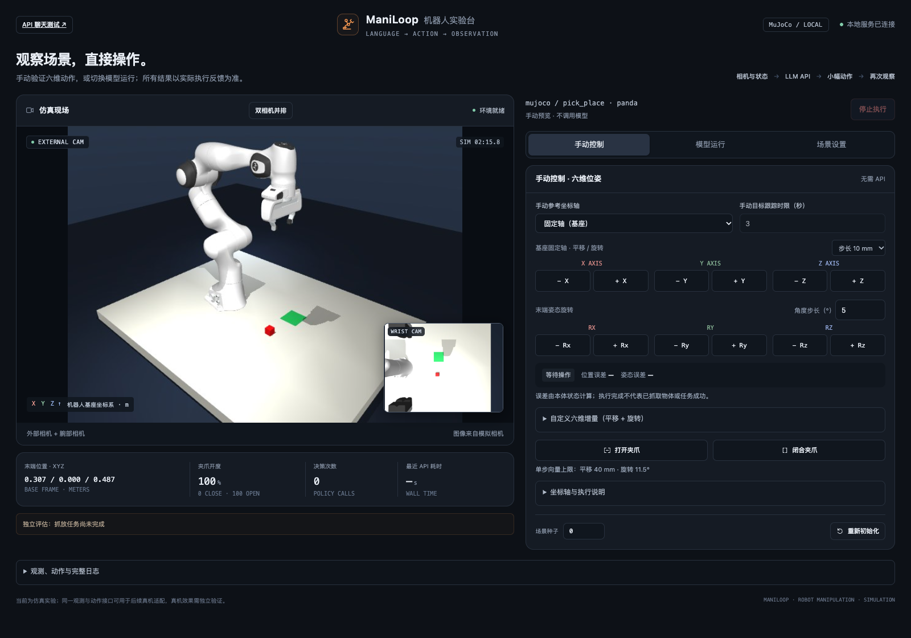
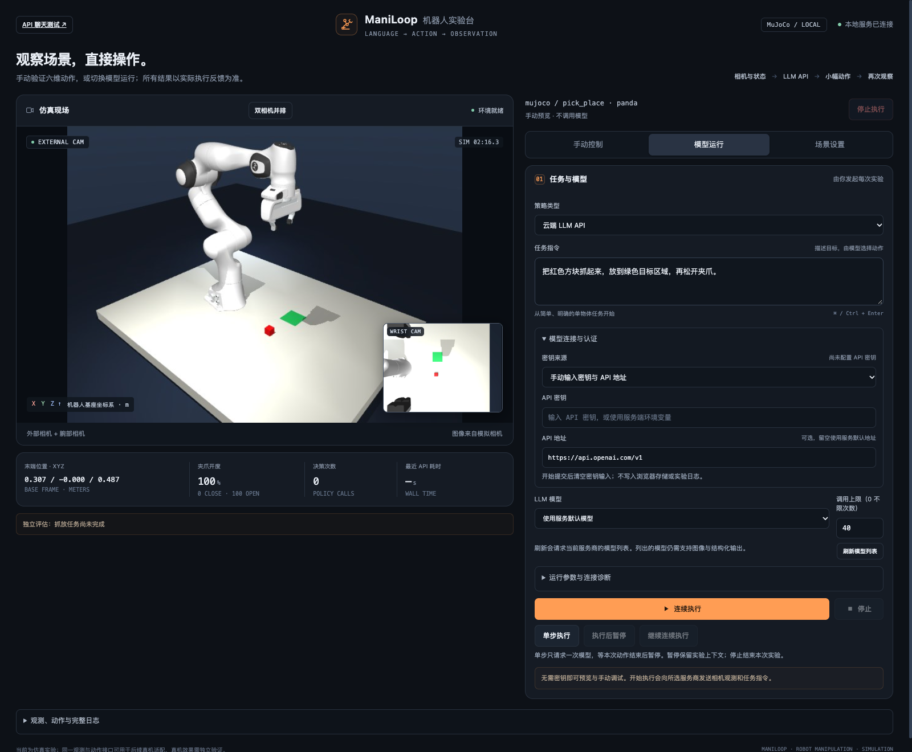

# ManiLoop

**[English](README.md)** · [简体中文](README.zh-CN.md)

**Closed-loop robot policy evaluation across simulation benchmarks.** Designed to support fair, reproducible comparisons across policies and task environments, ManiLoop brings built-in MuJoCo scenes, LIBERO, robosuite, and RoboCasa into one local browser workspace and CLI. Start with manual control, then use GPT, a compatible vision API, a supported local LeRobot checkpoint, or Jev text primitives.

**[Get started ↓](#step-1--open-the-local-workspace)** · [Connect a model](#step-3--connect-your-model) · [Observed results](docs/RESULTS.md#english) · [Project website](https://daniel-rmc.github.io/ManiLoop/?lang=en)



*The current local application in its Chinese interface, previewing the built-in Panda pick-and-place scene. These controls operate the simulator; the project website separately offers recorded episode playback.*

[Watch GPT place a bowl, turn a stove knob, and move cream cheese into a basket](https://daniel-rmc.github.io/ManiLoop/?lang=en#skills): play verified episodes, pause at each action, and read the model's recorded action notes alongside the controller feedback. Full videos and execution conditions are included.

These three recorded GPT successes took **5.5–11.1 minutes of episode wall time**, including model planning, communication, execution and recording, after scene and policy loading. These are selected examples, not average completion times or a speed ranking. [See timing and results](docs/RESULTS.md#recorded-wall-clock-time).

## What you can run

The workspace brings **camera observations, actions, controller feedback, and independent evaluation** together. Use manual controls, single-step model decisions, pause and resume, compare before/after observations, and run CLI experiment matrices. Complete control-step video capture is available for LIBERO in controlled timing; other backends provide decision logs and review frames.

| Backend | Robot and available tasks | Integration scope |
| --- | --- | --- |
| Built-in MuJoCo | ARX X5 / Franka Panda; `pick_place` and `push`; `tabletop_a` / `tabletop_b` | Contact-based tabletop manipulation, manual and model control, independent task evaluation |
| [LIBERO](docs/LIBERO.md) | Official Panda; five task suites | Official initial states, OSC controller, and success rules; selected real model episodes are published below |
| [robosuite](docs/ROBOSUITE.md) | Panda; `Lift`, `Stack`, `PickPlaceCan`, `Door`, `NutAssemblySquare` | Five integrated tasks with camera, stepping, reset, and evaluation checks; world-frame OSC adaptation |
| [RoboCasa](docs/ROBOCASA.md) | PandaOmron; `OpenDrawer`, `CloseDrawer`, `OpenCabinet`, `CoffeeSetupMug` | Four kitchen tasks; arm and gripper control, zero base velocity and torso delta; no navigation |

LIBERO's catalogs contain **10 spatial, 10 object, 10 goal, 90 `libero_90`, and 10 `libero_10` tasks**, covering object placement, drawers, stove control, stacking, and longer operations. These are catalog sizes, not counts of tasks completed by a model. RoboCasa's four-task interface checks use layout 11 / style 14 / seed 0 on macOS / Apple Silicon; other scene combinations and arm reachability need separate checks. Changing the instruction text does not change an upstream evaluator.

Vision policies receive images and robot sensor state; **Jev receives explicit text and proprioception only**. Object ground truth, simulator contacts, rewards, and success signals are excluded from every policy input. Independent evaluation can inspect simulator state and stop an episode; `done`, controller `reached`, and completion of a command sequence are distinct from task success.

The local workspace has three panels:

| Panel | What you do |
| --- | --- |
| Manual control | Translate and rotate the TCP in fixed or tool axes, open or close the gripper, and submit a combined six-dimensional increment. Inspect position and orientation errors. |
| Model execution | Enter instructions, choose a connection, run diagnostics, and use single-step, continuous execution, or pause/resume. |
| Scene settings | Choose a backend, task, robot, and scene parameters; apply the selection to rebuild the environment. |

Stop remains visible across panels. Switching panels or between picture-in-picture and side-by-side cameras does not start inference or advance physics. Manual control requires the current task, action, and request to have finished. The manual target-tracking budget is separate from the model budget; TCP rotations are not individual-joint commands. See [workspace usage](docs/WORKSPACE.md) and [six-dimensional manual control](docs/MANUAL_CONTROL.md).

## Step 1 · Open the local workspace

Use **Python 3.12**, Git, and an OpenGL-capable environment. Hosted GPT inference does not require local model weights or a local GPU. The base application needs neither ROS, Docker, nor a physical robot.

**macOS / Linux**

```bash
git clone https://github.com/Daniel-rmc/ManiLoop.git
cd ManiLoop
python3.12 -m venv .venv
source .venv/bin/activate
python -m pip install -r requirements.txt
python -m maniloop demo
```

**Windows PowerShell**

```powershell
git clone https://github.com/Daniel-rmc/ManiLoop.git
cd ManiLoop
py -3.12 -m venv .venv
.\.venv\Scripts\python.exe -m pip install -r requirements.txt
.\.venv\Scripts\python.exe -m maniloop demo
```

Open [http://127.0.0.1:8765](http://127.0.0.1:8765). The workspace starts in Manual control. Use Scene settings to select a robot, layout, and task, apply the configuration, then return to manual arm and gripper controls. **No API key is needed for this step.** The server listens on localhost; keep its terminal open and press `Ctrl+C` to stop it. Use `--port 8766` if needed.

Continue from the repository root after stopping the server. **Windows:** replace subsequent `python` commands with `.\.venv\Scripts\python.exe`; join multiline Bash examples into one line, removing trailing `\`. After installing `uv`, add `--uv .\.venv\Scripts\uv.exe` when running a setup script. No activation script or execution-policy change is required.

For headless Ubuntu/Debian, install `libosmesa6` and set `MUJOCO_GL=osmesa` before starting Python. EGL is another option with compatible drivers. These Linux settings do not apply to macOS.

<a id="run-gpt-on-libero"></a>

## Step 2 · Choose a simulation backend

The built-in scenes are ready after Step 1. Choose the optional backend you need from the sections below and run its commands from the repository root. Stop a running demo before following another launch example. Workers use separate interpreters; continue launching the workspace with the main environment's `python`.

```bash
python -m pip install uv
```

### LIBERO

```bash
python scripts/setup_libero.py
python -m maniloop list --backend libero --libero-suite libero_goal
python -m maniloop smoke --backend libero
python -m maniloop demo --backend libero --port 8767
```

Open [http://127.0.0.1:8767](http://127.0.0.1:8767). Select a suite, task ID, and initialization ID in Scene settings. IDs start at zero; `list` prints the available task names. The default is `libero_spatial` task 0, init 0: move the black bowl between the plate and ramekin onto the plate. Installation needs network access and several GB of disk space, but no demonstration dataset or policy weights. See [LIBERO setup](docs/LIBERO.md).

### robosuite

```bash
python scripts/setup_robosuite.py
python -m maniloop list --backend robosuite
python -m maniloop demo --backend robosuite --task Lift --port 8870
```

Open [http://127.0.0.1:8870](http://127.0.0.1:8870). The five Panda tasks use robosuite 1.5.2 / MuJoCo 3.3.7 in their own runtime. This adapter explicitly configures world-frame OSC and records that choice. Camera, manual control, and model interfaces are integrated; no model success rate is established for these tasks. See [control semantics and checks](docs/ROBOSUITE.md).

### RoboCasa

```bash
python scripts/setup_robocasa.py --download-assets
python -m maniloop list --backend robocasa
python -m maniloop demo --backend robocasa --task OpenDrawer \
  --robocasa-layout 11 --robocasa-style 14 --port 8872
```

Open [http://127.0.0.1:8872](http://127.0.0.1:8872). The installer pins RoboCasa and its compatible robosuite source separately from the standalone robosuite backend. Its five required asset groups occupy about 11.1 GB unpacked, plus source/runtime space. PandaOmron's arm and gripper are controlled while the base receives zero velocity and the torso receives zero delta; this is not a navigation interface. Default-scene interface verification does not establish autonomous task success or arm-only solvability in every scene. See [RoboCasa setup and limitations](docs/ROBOCASA.md).

### Keep runtimes separate

| Environment | Purpose |
| --- | --- |
| `.venv` · Python 3.12 | Main application, UI, model connections, bundled MuJoCo scenes |
| `.venv-libero` · Python 3.10 | LIBERO simulation and its pinned dependencies |
| `.venv-robosuite` · Python 3.11 | Standalone robosuite simulation |
| `.venv-robocasa` · Python 3.11 | RoboCasa simulation and its compatible upstream dependencies |
| `.venv-vla` · Python 3.12 | Optional LeRobot inference and learned policies |

Do not combine these dependencies into the main environment. The RoboCasa worker is a simulation installation, not the upstream training environment. Optional assets, environments, and model weights are downloaded locally and are not bundled in this repository.

## Step 3 · Connect your model

Choose one route below. Stop the existing server before running a different launch command.

| Model route | How to connect | Compatibility boundary |
| --- | --- | --- |
| ChatGPT plan direct | Select the direct route and authorize ManiLoop in your browser | Eligible account models through Responses, without Codex CLI; no server token hard cap in the current preview |
| GPT through Codex | Official Codex CLI login; select the Codex source | Uses models available to that CLI/account; ManiLoop does not extract login tokens |
| Hosted or self-hosted vision model | Enter the service base URL, model ID, and API key, or import provider TOML | Robot control requires **Responses API + image input + JSON Schema output** |
| Local LeRobot checkpoints | Select a supported model loaded by the isolated inference worker | Three reviewed LIBERO checkpoint presets; not arbitrary model-folder import |
| Jev text primitives | Enter a separate TypeSafe key in the model panel | Explicit text and robot proprioception; bounded arm/gripper commands, without images or object localization |

<details><summary>See model controls in the actual local application</summary>



*The current Model execution panel in its Chinese interface, with the built-in Panda scene loaded and no model request started. Its connections and instructions configure real execution; this is separate from the website's saved-data playground.*
</details>

### GPT / compatible model APIs

To use your ChatGPT plan directly, install `python -m pip install -e '.[chatgpt]'`, start the normal local demo, and choose **ChatGPT 套餐直连 · 独立授权** in the model panel. Click **Continue with ChatGPT**, authorize ManiLoop, refresh the account's model list, and run the text/image/action-format diagnostics. This route uses ManiLoop's own prompt and control loop without launching Codex CLI. Account eligibility and model access are verified by those diagnostics. See the [bilingual setup and comparison guide](docs/CHATGPT_PLAN.md).

The existing Codex CLI route remains available as a separate harness configuration:

Install a current official [Codex CLI](https://github.com/openai/codex), then:

```bash
codex login
python -m maniloop demo --backend libero --codex-login --port 8767
```

Choose the Codex source and load the GPT demo preset. This preset selects LIBERO; to work in another backend, keep that scene selected and configure the model directly. Start with the text/image/action-format diagnostics or a single action. `MANILOOP_CODEX_BIN` selects the executable if several CLI versions are installed. See [GPT controls](docs/GPT6_DEMO.md).

For an API connection, select the manual or imported-config source, enter your model ID and the provider’s base URL, then supply its key. Examples: [OpenAI configuration](examples/openai.example.toml), [custom provider configuration](examples/custom.example.toml). A model you host locally can use this route **if its server implements the required Responses protocol**; a local base URL can be `http://127.0.0.1:8000/v1`. A Chat Completions-only server is not compatible with robot control; the separate [text chat page](docs/API_CHAT.md) supports both protocols. Selecting a model ID does not guarantee it supports vision or structured actions. Requests consume the selected account quota or provider billing; opening the page does not start inference.

### Local SmolVLA, ACT, and Diffusion Policy

```bash
python scripts/setup_vla.py --models smolvla-libero act-libero diffusion-libero
python -m maniloop demo --backend libero --port 8767
```

Select the local LeRobot source and a downloaded model. Omit `--models` to install only SmolVLA. These presets remain **LIBERO-only**, including when other backends are installed. Inference runs offline on CPU, Apple MPS, or CUDA; the checkpoint’s saved preprocessing and action queue are retained.

Or run a local checkpoint from the CLI; replace `smolvla-libero` with `act-libero` or `diffusion-libero` to select another installed preset:

```bash
python -m maniloop benchmark --backend libero --agent lerobot \
  --local-model smolvla-libero --libero-suite libero_spatial --libero-task-id 0 \
  --init-state-id 0 --seed 0 --max-calls 500 --max-sim-seconds 25 \
  --max-wall-seconds 1800 --output runs/local-demo
```

| Preset | Checkpoint | Input |
| --- | --- | --- |
| `smolvla-libero` | [lerobot/smolvla_libero](https://huggingface.co/lerobot/smolvla_libero) · official | Images, robot state, language |
| `act-libero` | [Deepkar/libero-test-act](https://huggingface.co/Deepkar/libero-test-act) · community | Images and robot state |
| `diffusion-libero` | [ttotmoon/diffusion-libero-v3](https://huggingface.co/ttotmoon/diffusion-libero-v3) · community | Images and robot state |

To use these presets **already stored on another local disk**, set `MANILOOP_MODELS_ROOT` to their parent directory. It must contain the preset-named folders, such as `smolvla-libero/`, plus `smolvlm-tokenizer/` for SmolVLA. `MANILOOP_VLA_PYTHON` can point to a compatible inference environment. These options relocate supported snapshots; they do not import arbitrary Hugging Face repositories or custom weights. Details and fixed revisions: [local model guide](docs/VLA.md).

### Jev: explicit text commands

In Model execution, select **Jev · 文本原语控制** and enter a TypeSafe API key. The key is separate from OpenAI connections and stays in server memory, not files or browser storage. Saving it does not call the model; the connection diagnostic and command execution use the TypeSafe API. No Jev weights or TypeSafe SDK installation is needed.

Use one action per line, for example:

```text
Move up along world Z by 10 mm.
Rotate about the tool Z axis by 5 degrees.
Open the gripper.
```

Jev selects a bounded primitive from text and robot proprioception; local code handles units, frames, and execution. It receives no camera images and cannot locate an object for autonomous grasping. Controlled timing is required. A sequence supports up to 20 lines and stops on ambiguous commands, low candidate probability, API errors, or failed control. Its existing simulation checks use mocked Jev responses; real service behavior requires a separate diagnostic or command run. See [Jev setup and verification scope](docs/JEV.md).

### Integrating your own checkpoint or policy

A new checkpoint needs its own model registration, correct preprocessing and action mapping, and source metadata. Do not replace a preset’s files and treat the result as that preset. For a custom inference implementation, implement [`Agent`](src/maniloop/agents/base.py): `reset()` and `decide(task, observation, images, history, geometry_results)`, returning an action dictionary or [`ActionChunk`](src/maniloop/core/actions.py). Connect it to `EpisodeRunner`, and add a CLI/UI choice if needed; there is no automatic arbitrary-checkpoint loader.

A new simulation backend implements [`Environment`](src/maniloop/backends/base.py) and is registered through the [environment factory](src/maniloop/backends/factory.py). Match camera/state inputs, action dimensions, units, and timing, while keeping evaluation separate. See [architecture and extension interfaces](docs/ARCHITECTURE.md).

## Step 4 · Record a run and inspect its result

For ordinary model runs, inspect the decision log, controller feedback, before/after frames, and independent result. Complete control-step recording and video export currently require **LIBERO with controlled timing**. The following runs a new GPT-6 attempt from official initialization and records every control step:

```bash
python -m maniloop benchmark \
  --backend libero --libero-suite libero_spatial --libero-task-id 0 \
  --init-state-id 0 --seed 0 --agent llm_cloud --codex-login \
  --model gpt-6-astra --context-mode paired --reasoning-effort medium \
  --max-calls 0 --max-wall-seconds 3600 --record-episode \
  --output runs/gpt-demo
```

Default `controlled` timing pauses physics during inference. `--max-calls 0` removes the decision-count cap; official termination, simulation limits, and the wall-clock budget still apply. Each attempt gets a separate directory containing `manifest.json`, `events.jsonl`, `result.json`, and `replay.html`. Inspect **`result.json → evaluation.success`** for the independent outcome; open `replay.html` locally for decision-by-decision review. Full frames and integrity metadata are in `recording/`.

With `ffmpeg` installed, export the video:

```bash
python -m maniloop.recording.video runs/gpt-demo/EPISODE_ID/recording
```

Replace `EPISODE_ID` with the actual run directory name. The exporter checks frame order and hashes before creating `episode.mp4`; use `--ffmpeg /path/to/ffmpeg` if needed. Failed runs remain saved and can be exported with `--allow-failure`. Playback follows simulation time and omits frozen model waiting. See [recording and export](docs/EPISODE_RECORDING.md). To batch the three local models using the [example matrix](examples/libero-local-suite.toml), run `python -m maniloop benchmark --suite examples/libero-local-suite.toml --output runs/local-suite`.

## Recorded examples and observed results

[Explore the recorded workspace](https://daniel-rmc.github.io/ManiLoop/playground/?lang=en) or [watch the successful episode](https://daniel-rmc.github.io/ManiLoop/?lang=en#demo) without installing anything. The public replay uses saved data; **new tasks and model calls run in the local application**. Try “Single step”, compare “Before action” / “After action”, and jump to decision 46’s final frame.

The GPT episode contains 46 decisions and 706 control steps, including grasp retries. Its complete video has 707 dual-camera frames at 20 fps, lasting 35.35 seconds. Official success triggered during the final lowering action; the environment stopped immediately without an additional release or retreat check.

| Model | Official outcome | GPT requests / local inferences | Control steps | Simulation time |
| --- | --- | ---: | ---: | ---: |
| GPT-6 Astra | Success | 46 | 706 | 35.30 s |
| SmolVLA | Success | 2 | 78 | 3.90 s |
| ACT | Not successful within budget | 5 | 500 | 25.00 s |
| Diffusion Policy | Success | 10 | 79 | 3.95 s |

Each row is **one selected run** on `libero_spatial` task 0 / init 0 / seed 0, not a success rate or ranking. GPT produces high-level actions; local inference generates queues consumed over multiple control steps. Inputs, controllers, budgets, and execution paths differ, so wall-clock times are not directly comparable. New model runs may produce different outcomes. [Full results and conditions](docs/RESULTS.md#english).

## Guides, checks, and scope

[Workspace](docs/WORKSPACE.md) · [Manual control](docs/MANUAL_CONTROL.md) · [LIBERO](docs/LIBERO.md) · [robosuite](docs/ROBOSUITE.md) · [RoboCasa](docs/ROBOCASA.md) · [GPT controls](docs/GPT6_DEMO.md) · [Jev](docs/JEV.md) · [Local checkpoints](docs/VLA.md) · [API text chat](docs/API_CHAT.md) · [Recording](docs/EPISODE_RECORDING.md) · [Architecture](docs/ARCHITECTURE.md)

```bash
python -m pip install -r requirements-dev.txt
python -m pytest -q
python -m maniloop smoke
```

These checks do not make model requests. Offline tests cover macOS, Linux, and Windows; main-application rendering has been verified on macOS and Linux OSMesa. Optional backends have their own opt-in integration checks in the linked guides; ordinary pytest does not validate an uninstalled backend. Rendering and LIBERO execution on Windows have not been validated. Rendering needs a graphics backend. ManiLoop is simulation software: the ARX gripper is approximate, and real-robot control or safety has not been validated. Environment integration, controller checks, and real model task outcomes are reported separately.

<a id="许可证与贡献"></a>

## License

ManiLoop is [MIT licensed](LICENSE). ARX X5 assets retain MIT; Panda assets retain Apache-2.0. LIBERO, robosuite, RoboCasa, LeRobot, and downloaded assets and checkpoints retain their own licenses. See [third-party notices](THIRD_PARTY_NOTICES.md) and [contributing](CONTRIBUTING.md).
